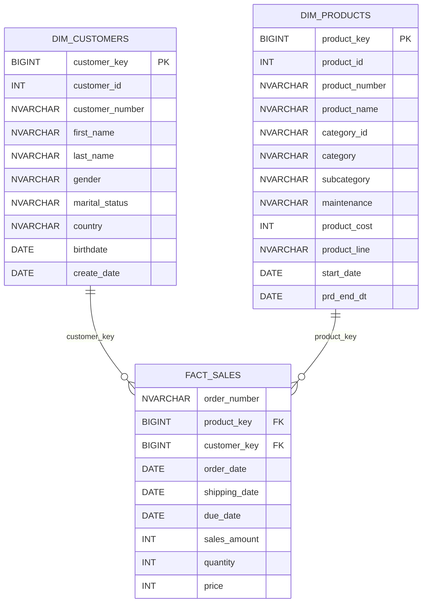

# Gold Layer Data Dictionary

## 1. Overview

The Gold Layer represents the business-ready data layer of the Data Warehouse. It contains structured views designed for reporting, analytics, and business intelligence.

The Gold Layer follows a **Star Schema**, consisting of two dimension views and one fact view.

| View Name | Object Type | Description |
|---|---|---|
| `gold.dim_customers` | Dimension | Stores customer information, including demographic and geographic attributes. |
| `gold.dim_products` | Dimension | Stores current product information, including category and cost details. |
| `gold.fact_sales` | Fact | Stores sales transactions linked to customers and products. |

---

## 2. gold.dim_customers

**Description:** Stores consolidated customer information by integrating CRM customer records with ERP demographic and location data.

**Primary Key (Logical):** `customer_key`

| Column Name | Data Type | Description | Source |
|---|---|---|---|
| customer_key | BIGINT | Surrogate key uniquely identifying each customer record. | Generated using ROW_NUMBER() |
| customer_id | INT | Unique customer identifier from the CRM system. | crm_cust_info.cst_id |
| customer_number | NVARCHAR(50) | Business identifier assigned to the customer. | crm_cust_info.cst_key |
| first_name | NVARCHAR(50) | Customer's first name. | crm_cust_info.cst_firstname |
| last_name | NVARCHAR(50) | Customer's last name. | crm_cust_info.cst_lastname |
| gender | NVARCHAR(50) | Customer's gender, prioritizing CRM data and falling back to ERP data when CRM contains 'n/a'. | CRM / ERP |
| marital_status | NVARCHAR(50) | Customer's marital status. | crm_cust_info.cst_marital_status |
| country | NVARCHAR(50) | Customer's country of residence. | erp_loc_a101.cntry |
| birthdate | DATE | Customer's date of birth. | erp_cust_az12.bdate |
| create_date | DATE | Date the customer record was created in CRM. | crm_cust_info.cst_create_date |

### Transformation Rules

- Generates `customer_key` using `ROW_NUMBER()` ordered by customer ID.
- Integrates CRM and ERP customer information using LEFT JOIN operations.
- Prioritizes CRM gender when its value is not `n/a`.
- Uses ERP gender as a fallback, defaulting to `n/a` when ERP gender is NULL.
- Retains CRM customer records even when corresponding ERP information is unavailable.

---

## 3. gold.dim_products

**Description:** Stores current product information enriched with product category, subcategory, and maintenance details.

**Primary Key (Logical):** `product_key`

| Column Name | Data Type | Description | Source |
|---|---|---|---|
| product_key | BIGINT | Surrogate key uniquely identifying each product record. | Generated using ROW_NUMBER() |
| product_id | INT | Unique product identifier from the CRM system. | crm_prd_info.prd_id |
| product_number | NVARCHAR(50) | Business identifier assigned to the product. | crm_prd_info.prd_key |
| product_name | NVARCHAR(50) | Name of the product. | crm_prd_info.prd_nm |
| category_id | NVARCHAR(50) | Identifier representing the product category. | crm_prd_info.cat_id |
| category | NVARCHAR(50) | Product's main category. | erp_px_cat_g1v2.cat |
| subcategory | NVARCHAR(50) | Product's subcategory. | erp_px_cat_g1v2.subcat |
| maintenance | NVARCHAR(50) | Indicates the product's maintenance classification or requirement. | erp_px_cat_g1v2.maintenance |
| product_cost | INT | Cost associated with the product. | crm_prd_info.prd_cost |
| product_line | NVARCHAR(50) | Product line or classification. | crm_prd_info.prd_line |
| start_date | DATE | Date from which the product record became effective. | crm_prd_info.prd_start_dt |
| prd_end_dt | DATE | Date the product record expired; NULL for currently active records. | crm_prd_info.prd_end_dt |

### Transformation Rules

- Generates `product_key` using `ROW_NUMBER()` ordered by product ID and product number.
- Enriches product records with category information from the ERP system.
- Uses a LEFT JOIN to preserve product records without matching category information.
- Includes only current product records using the condition `prd_end_dt IS NULL`.

---

## 4. gold.fact_sales

**Description:** Stores sales transaction details and connects sales records with customer and product dimensions for analytical reporting.

**Grain:** One row per source sales-detail record.

| Column Name | Data Type | Description | Source |
|---|---|---|---|
| order_number | NVARCHAR(50) | Business identifier of the sales order. | crm_sales_details.sls_ord_num |
| product_key | BIGINT | Surrogate key referencing the product dimension. | gold.dim_products.product_key |
| customer_key | BIGINT | Surrogate key referencing the customer dimension. | gold.dim_customers.customer_key |
| order_date | DATE | Date on which the order was placed. | crm_sales_details.sls_order_dt |
| shipping_date | DATE | Date on which the order was shipped. | crm_sales_details.sls_ship_dt |
| due_date | DATE | Expected due date of the order. | crm_sales_details.sls_due_dt |
| sales_amount | INT | Total sales amount associated with the transaction. | crm_sales_details.sls_sales |
| quantity | INT | Number of product units sold. | crm_sales_details.sls_quantity |
| price | INT | Selling price per product unit. | crm_sales_details.sls_price |

### Transformation Rules

- Retrieves sales transaction data from `silver.crm_sales_details`.
- Resolves product surrogate keys by matching `sls_prd_key` with `product_number`.
- Resolves customer surrogate keys by matching `sls_cust_id` with `customer_id`.
- Uses LEFT JOIN operations to preserve sales records even when matching dimension records are unavailable.
- Product and customer surrogate keys may be NULL when no matching dimension record exists.

---

## 5. Data Model Relationships

The Gold Layer follows a Star Schema with the following logical relationships:

| Fact View | Foreign Key | Dimension View | Referenced Key | Relationship |
|---|---|---|---|---|
| gold.fact_sales | customer_key | gold.dim_customers | customer_key | Many-to-One |
| gold.fact_sales | product_key | gold.dim_products | product_key | Many-to-One |

### Star Schema Diagram

## 6. Important Notes

- The documented data types are expected SQL Server types and should be verified against the underlying Silver Layer schema.
- Primary and foreign keys represent logical relationships; SQL Server views do not automatically enforce these constraints.
- Surrogate keys generated using `ROW_NUMBER()` are calculated dynamically and may change if the underlying data changes.
- The fact view does not define a separate unique transaction key.
- The product dimension contains only current product records, not historical versions.
- The Gold Layer views do not store data physically; they retrieve and transform data from their underlying sources.
